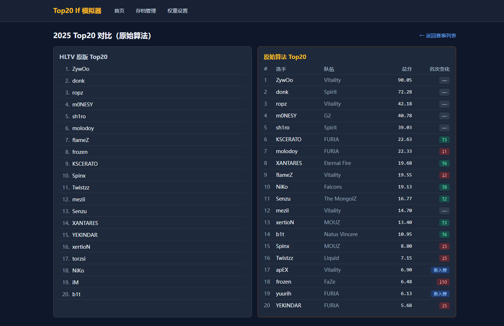
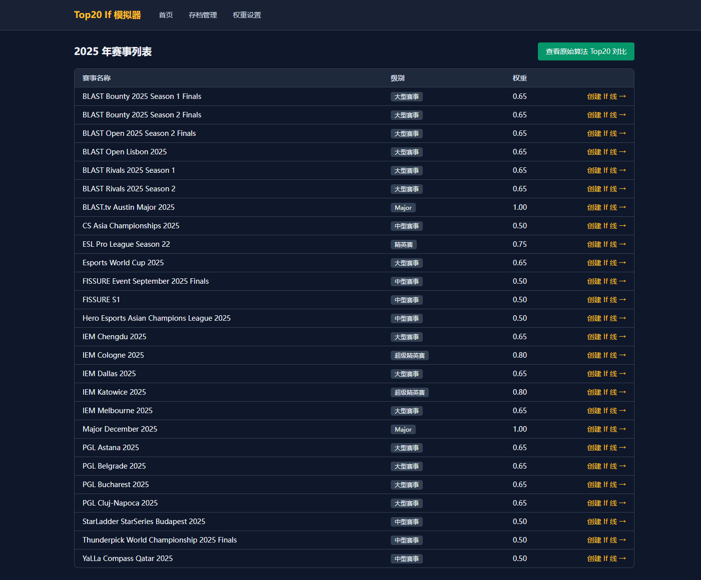
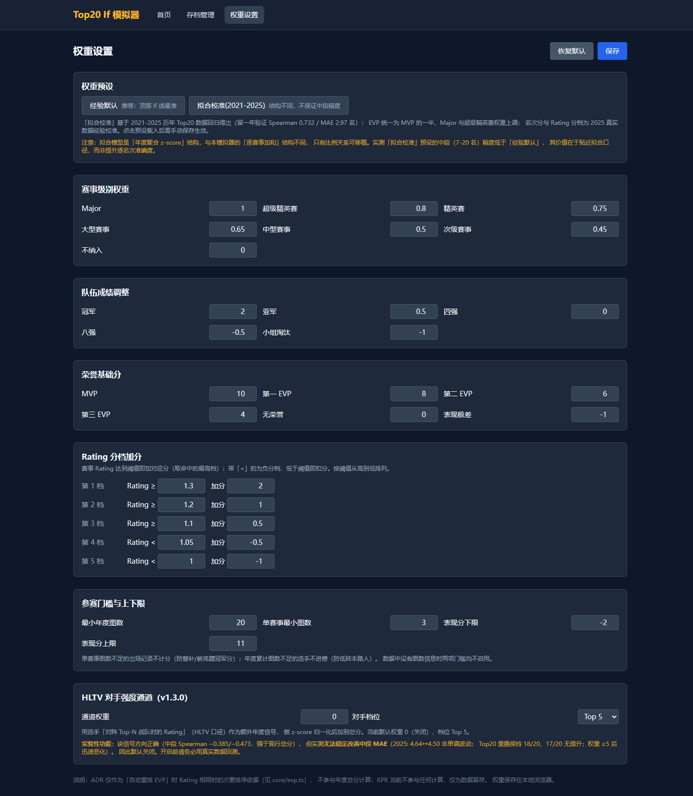
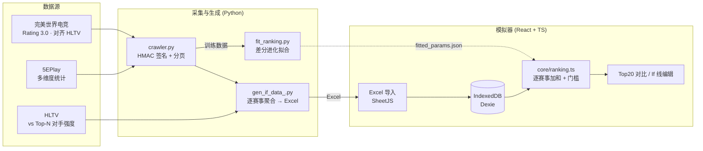

# IFTV · CS2 选手年度排名与 If 线模拟器

<p align="center">
  
</p>

<p align="center">
  <em>左：HLTV 官方 Top20　·　右：模型复现结果　·　实时标注名次升降</em>
</p>

<p align="center">
  <a href="LICENSE"></a>
  
  
  
  
  
</p>

---

用**可解释的参数化模型**复现 HLTV 年度 Top20 的排名逻辑，并支持 What-if 情景模拟：

> 「如果 donk 赢了那届上海 Major，谁会进 Top20？」
> 「把这届的 MVP 转给另一个人，排名会怎么变？」

**不是黑盒。** 每个选手的分数都能拆成「荣誉 + 个人数据 + 队伍成绩」三部分，所有权重都能在界面上改。

---

## ✨ 项目亮点

| | |
|---|---|
| 🎯 **头部高度还原** | 前 6 名两年**基本全中**（2025 头部 MAE 0.17，Spearman +1.000） |
| 🔧 **完全可解释** | 单赛事表现分 = 荣誉基础分 + rating 分档 + 队伍名次分，逐项可调 |
| 🎛️ **What-if 模拟** | 改冠军 / 改 MVP / 重排 EVP，全年总分实时重算 |
| 📊 **真·回测** | 2024 + 2025 两年真实数据，与官方 Top20 逐名对比 |
| 🧪 **严谨的证伪记录** | 11 轮改进尝试全部归档，含失败的跨年验证 |
| 🖥️ **纯前端** | 无后端，数据存 IndexedDB，双击即用 |

---

## 🎬 界面预览

<table>
<tr>
<td width="50%">

**赛事列表**（26 个赛事，自动分级与权重）



</td>
<td width="50%">

**权重设置**（所有权重可改，含预设）



</td>
</tr>
</table>

---

## 🚀 快速开始

### 方式 A · 双击启动（推荐，零依赖）

**双击根目录的 `启动模拟器.bat`** —— 自动起本地服务器并打开浏览器。

- 优先用 Python，没有则自动改用 Node.js
- 端口被占用会自动向后找空闲端口
- 关闭窗口即停止服务

> **为什么不能直接双击 `dist/index.html`？**
> 现代浏览器禁止 `file://` 页面加载 ES Module（CORS 策略），
> 而 Vite 产物必然是 module，所以必须经 HTTP 访问。
> 实测报错：`Access to script at 'file:///...' has been blocked by CORS policy`。
> 这是协议层面的限制，改相对路径也无效。

也可手动起服务器（三条命令等价，均无第三方依赖）：

```bash
python serve.py      # Python 标准库
node serve.js        # Node 版
cd if-simulator/dist && python -m http.server 8000
```

### 方式 B · 开发模式

```bash
cd if-simulator
npm ci
npm run dev          # http://localhost:5173
```

### 导入数据

浏览器打开后依次导入包内两个文件：

| 按钮 | 文件 |
|---|---|
| 「导入赛事数据 Excel」 | `data/if_sim_2025_events.xlsx` |
| 「导入 HLTV 原版 Top20」 | `data/if_sim_2025_baseline.xlsx` |

> 另有 2024 年两套文件，注意**导入会互相覆盖**。
> 清空浏览器数据：控制台执行 `indexedDB.deleteDatabase('if-simulator')`。

---

## 🏗️ 架构



**三个组件：**

| 组件 | 入口 | 职责 |
|---|---|---|
| 数据采集 | `crawler.py` | 完美世界（HMAC 签名）+ 5EPlay 双源采集 |
| 参数拟合 | `fit_ranking.py` | 差分进化拟合评分公式 + 留一年验证 |
| If 线模拟器 | `if-simulator/` | 纯前端排名重算与对比 |

---

## 🧮 算法

### 总分

```
总分 = Σ(单赛事表现分 × 赛事权重) + 对手强度通道（默认关闭）
```

### 单赛事表现分（截断到 `[-2, 11]`）

```
荣誉基础分   MVP 10 · 第一EVP 8 · 第二EVP 6 · 第三EVP 4 · 无 0
rating 分档  ≥1.3:+2 · ≥1.2:+1 · ≥1.1:+0.5 · <1.05:−0.5 · <1.0:−1
队伍名次     冠军 +2 · 亚军 +0.5 · 四强 0 · 八强 −0.5 · 小组淘汰 −1
```

### 赛事权重

```
Major 1.00 · 超级精英赛 0.80 · 精英赛 0.75 · 大型赛事 0.65
中型赛事 0.50 · 次级赛事 0.45 · 不纳入 0
```

### 两道参赛门槛

- **单赛事 < 3 图**不计分 → 防替补/教练蹭冠军分
- **年度 < 20 图**不进榜 → 防低样本路人

> 全部默认值集中在 `if-simulator/src/config/defaults.ts`，
> 计算逻辑为独立纯函数（`core/`），界面上每一项都可覆盖。

---

## 📊 回测结果

用 2024 / 2025 两年真实数据与官方 Top20 逐名对比（对手强度通道关闭时的默认配置）：

<table>
<tr><th>年份</th><th>区间</th><th>MAE（名）</th><th>Spearman</th><th>Top20 重叠</th></tr>
<tr><td rowspan="3">2025</td><td><b>头部 1-6</b></td><td><b>0.17</b></td><td><b>+1.000</b></td><td rowspan="3"><b>18 / 20</b></td></tr>
<tr><td>中段 7-20</td><td>4.64</td><td>+0.336</td></tr>
<tr><td>全体 1-20</td><td>3.30</td><td>+0.768</td></tr>
<tr><td rowspan="3">2024</td><td><b>头部 1-6</b></td><td><b>1.00</b></td><td><b>+0.714</b></td><td rowspan="3"><b>17 / 20</b></td></tr>
<tr><td>中段 7-20</td><td>5.21</td><td>+0.196</td></tr>
<tr><td>全体 1-20</td><td>3.95</td><td>+0.717</td></tr>
</table>

- **数据规模**：2025 年 26 赛事 / 1735 行；2024 年 22 赛事 / 1567 行
- **前 5 名两年全中**
- 拟合模型（另一套结构）留一年验证：**Spearman 0.732 / MAE 2.97 名**

---

## ⚠️ 能力边界（重要）

**这个模拟器擅长顶部，不擅长中段。**

中段（7-20 名）的次序复现有限，而且**这不是实现缺陷，是信息上界** ——
我们做了 11 轮尝试，全部归档可查：

<details>
<summary><b>11 轮尝试的结果（点击展开）</b></summary>

| # | 尝试 | 结果 |
|---|---|---|
| 1-4 | 调参：rating 连续化 / EVP 分值 / 名次缩放 / z-score 归一化 | ❌ 全部更差或无效 |
| 5 | 补 HLTV 对手强度（完美 API） | ❌ 该接口不支持按年份取数 |
| 6 | 用已有字段构造对手强度 | ❌ MAE 与重叠同时恶化 |
| 7 | 分段重排（锁头部，中段换信号） | ❌ 无法同时改善两年 |
| 8-9 | 逐图稳定性信号（std / 变异系数 / 趋势） | ❌ 跨年验证双向失败 |
| 10 | HLTV 对手强度采集（真实浏览器 + CDP） | ✅ 采集成功，40/40 人 |
| 11 | 将对手强度接入评分 | ❌ 信号方向正确但无法稳定改善 MAE |

</details>

**为什么**：官方中段排序依据的是**对手质量拆分**与**全年聚合稳定性**，
现有数据源难以完整提供。中段只有 14 人/年 × 2 年样本，任何调参都极易过拟合
（第 8-9 轮就是活例：单年看着改善，跨年一测就崩）。

**所以**：把模拟器用于**顶部 If 线分析**（前 6 名两年全中），
中段名次当作参考值。

> 完整的诊断过程、所有证伪实验与被推翻的中间结论，都保留在
> [`.analysis/`](.analysis/) 中 —— 包括两次**自我更正**（错误的 z-score 池
> 曾导致虚假改善，后被查出并推翻）。科研记录的价值在于可追溯，不在于好看。

### 其它已知边界

1. **两个数据源的 Rating 口径不可混用** —— 完美是 Rating 3.0（对齐 HLTV），5E 是自有口径
2. **选手 ID 有三套命名空间** —— 完美主站 / nami 比赛接口 / HLTV，跨源必须按**选手名**关联
3. **只有 2024/2025 两年**可验证；继续改进需先扩大样本（补采 2021-2023）

---

## 📁 目录结构

```
IFTV-TOP20/
├── 启动模拟器.bat            # ← 双击即用（GBK 编码，勿转存 UTF-8）
├── serve.py / serve.js       # 便携静态服务器（无第三方依赖）
│
├── crawler.py                # 采集器：完美世界 + 5EPlay
├── gen_if_data_2025.py       # 赛事 Excel 生成（模拟器导入格式）
├── fit_ranking.py            # 参数拟合（差分进化 + 留一年验证）
├── fetch_hltv_opponents.py   # HLTV 对手强度采集（真实浏览器 + CDP）
├── parse_hltv_html.py        # HLTV 手工导出页解析（备选方案）
├── fitted_params.json        # 拟合结果（2021-2025）
│
├── data/                     # 数据集与基准
├── if-simulator/             # 模拟器源码 + dist 预构建产物
│   ├── src/core/             # 算法纯函数（score / ranking / evp / scenario）
│   ├── src/config/defaults.ts# 全部默认权重
│   └── dist/                 # 已构建，便携启动器直接使用
└── .analysis/                # 诊断报告与验证脚本
```

### 数据文件

| 文件 | 内容 |
|---|---|
| `data/if_sim_2025_events.xlsx` | 2025 赛事数据，26 赛事 / 1735 行 |
| `data/if_sim_2025_baseline.xlsx` | 2025 官方 Top20 基准 |
| `data/if_sim_2024_events.xlsx` | 2024 赛事数据，22 赛事 / 1567 行 |
| `data/hltv_opponent_*.xlsx` | HLTV 对手强度（vs Top5/10/20/30/50） |
| `data/CS2选手排名数据_*.xlsx` | 爬虫多表原始输出 |

---

## 📚 文档

| 文档 | 内容 |
|---|---|
| [`大纲.md`](大纲.md) | 项目原始规格说明书 |
| [`HLTV_MANUAL_EXPORT.md`](HLTV_MANUAL_EXPORT.md) | HLTV 数据手工导出与解析流程 |
| [`.analysis/REPORT.md`](.analysis/REPORT.md) | 中段误差根因诊断 |
| [`.analysis/FINDINGS-*.md`](.analysis/) | 11 轮改进的完整实验记录 |

---

## 🔧 数据采集

### 完美世界 + 5EPlay

```bash
python -m venv .venv
.venv\Scripts\python.exe -m pip install -r requirements.txt
.venv\Scripts\python.exe crawler.py            # 全量采集
.venv\Scripts\python.exe gen_if_data_2025.py   # 生成模拟器导入用 Excel
```

### HLTV 对手强度（真实浏览器 + CDP）

hltv.org 由 Cloudflare 保护（JS Challenge），纯 HTTP 客户端与 headless 浏览器
都会被拦。方案是**用真实 Edge 浏览器**访问，再用内置 CDP 读取渲染结果：

```bash
# 1. 启动 Edge（带调试端口）
& "C:\Program Files (x86)\Microsoft\Edge\Application\msedge.exe" `
  --remote-debugging-port=9411 --user-data-dir="<目录>\edge_profile" `
  --disable-blink-features=AutomationControlled about:blank

# 2. 采集
.venv\Scripts\python.exe fetch_hltv_opponents.py --year 2025 --out data\hltv_opponent_2025.xlsx
```

> 端口默认 `9411`（`9333` 常被华硕 Armoury Crate 占用）。

---

## 📦 依赖

| 端 | 依赖 |
|---|---|
| **Python** | `requests` · `openpyxl` · `numpy` · `scipy` |
| **Node** | React 18 · TypeScript 5 · Vite 5 · Tailwind 3 · Dexie 4 · SheetJS |

`.venv/` 与 `node_modules/` **未纳入仓库**，按上文命令重建即可。

---

## 📄 License

[MIT](LICENSE)

---

<details>
<summary><b>数据来源与合规说明</b></summary>

统计数据来自第三方公开接口，仅用于技术研究与学习：

- **完美世界电竞**（data.wanmei.com）— Rating 3.0 口径，对齐 HLTV
- **5EPlay**（5eplay.com）— 多维度统计
- **HLTV**（hltv.org）— 对手强度（vs Top-N Rating）

关于 HLTV 采集（`fetch_hltv_opponents.py`）：

- 使用**真实浏览器**访问公开页面，由浏览器自身完成 Cloudflare 的 JS 挑战，
  脚本仅读取已渲染的内容，**不绕过任何访问控制**
- 采集频率低（每人 1 次请求），仅获取公开的选手统计数据，
  不涉及登录态或非公开内容
- 请遵守各站点服务条款与 robots 规则；如需大量采集请先取得授权

CS2 及 Counter-Strike 是 Valve Corporation 的商标。
本项目与 Valve、HLTV、完美世界、5EPlay 均无隶属关系。

</details>
